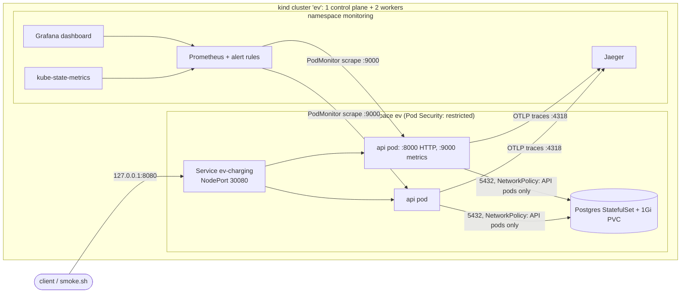
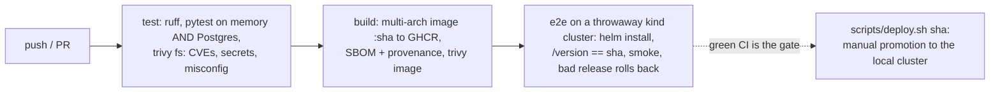

# DevOps design and decisions

Baseline [`2d5080b`](https://github.com/khopade-works/ev-charging-backend/commit/2d5080bca198149bf84ac43b15528213584ef707) (tag `baseline`): a FastAPI service with an in-memory store, one `threading.Lock` and pytest suites. It had no container, CI, deployment, persistence or telemetry. Run instructions are in the [README](../README.md#run-it-on-kubernetes), alert responses are in the [runbook](RUNBOOK.md), and the proof is in [evidence](evidence/README.md).

## Architecture

**Request path.** `curl 127.0.0.1:8080` goes to host port 8080, which kind maps to node port 30080 (bound to 127.0.0.1 only). kube-proxy then picks a Ready API pod. Inside the pod, uvicorn hands the request to the FastAPI route and then to `ChargingService`, which takes its in-process lock and then `PostgresStore.transaction()`. That transaction connects, takes `pg_advisory_xact_lock(1)` and loads the state row. The baseline domain code then runs unchanged, the state row is saved, and the transaction commits before the JSON response goes back. The middleware counts the request, records its latency and writes one JSON log line with the trace id. OpenTelemetry exports the HTTP span and the SQL spans to Jaeger.

| Component | Choice | Why |
|---|---|---|
| API | Deployment, 2 replicas | Stateless once the state is in Postgres, so pods are interchangeable. With 2 replicas, a rolling update or the loss of one node never drops to zero. `topologySpreadConstraints` puts them on different nodes. |
| Postgres | StatefulSet, 1 replica, PVC | Needs a stable name and the same volume after a restart. One replica is enough for a local system; in a cloud I'd use a managed database. |
| Store design | Whole state as one row, under one advisory lock | It keeps the baseline's correctness model (one global lock, check-then-act is safe) across replicas, with zero changes to the domain code. A race test with 2 replicas on one database fails without the lock (see [evidence](evidence/README.md)). **Ceiling:** every call loads all the state and writes are serialised. That is fine for this app, but the next step is a table per aggregate plus a conditional claim (`UPDATE … WHERE status='AVAILABLE'`). |
| Probes | liveness `/version` (no I/O); readiness `/readyz` (`SELECT 1`) | If the database is down, restarting the API won't fix it, so liveness must not depend on it. Readiness does depend on it, so the Service stops routing to pods that can't serve. Both probes are `async`, so they never queue behind requests in the threadpool. |
| Resources | requests set; memory limit; no CPU limit | The memory limit contains leaks. A CPU limit would throttle and add latency, while the request already guarantees a fair share. |

**Failure boundaries.**

| Failure | Users see | Contained by |
|---|---|---|
| One API pod dies | nothing | the other replica serves; liveness restarts it |
| Postgres down | errors until it's back | readiness takes the API pods out of the Service; the StatefulSet recreates the pod on the same PVC; every transaction opens a fresh connection, so recovery needs no restart |
| Bad release that never becomes Ready | nothing | `maxUnavailable: 0` keeps the old pods serving, and `helm --rollback-on-failure` restores the previous revision |
| Bad release that is Ready but wrong | errors | smoke test and SLO alert, then `helm rollback` |
| A client vanishes while holding the lock | stalls of up to 10 s | `idle_in_transaction_session_timeout=10s` releases the lock |

## CI/CD and release

| Decision | Alternatives | Why / when I'd switch |
|---|---|---|
| GitHub Actions, jobs test → build → e2e | Jenkins, GitLab CI | The code is on GitHub, the runners are free and there is no CI server to run. |
| Image tag = full git sha | `latest`, semver | Immutable and traceable: commit → image tag → `app.kubernetes.io/version` pod label → `GET /version` → `helm history` description. |
| Build once, deploy that artifact | rebuild per environment | The image that passed the scans and e2e is the image that runs. |
| e2e on kind for every change | mocks, no deploy test | Proves the chart installs, the pods become Ready, the user journey works, and a bad release rolls back. |
| Manual `scripts/deploy.sh <sha>`, refused without a green CI run | push-based CD, Argo CD | GitHub runners can't reach a laptop cluster. A self-hosted runner on a public repo would let any PR run code on my machine. So the manual step is the approval. With a reachable cluster I'd use Argo CD (pull-based, corrects drift). |
| Rolling update, `maxSurge 1 / maxUnavailable 0`, `preStop` sleep | blue-green, canary | Two stateless replicas and an unchanging schema make rolling updates zero-downtime. Canary needs traffic splitting and real traffic to judge; blue-green doubles the resources. |
| Rollback with `helm --rollback-on-failure` / `helm rollback` | `kubectl rollout undo` | Helm rolls back image and config together, and keeps a history of `sha=… ci=…`. |

**Configuration and drift.** Everything comes from one chart and one `values.yaml`, with no copies per environment. The only differences between environments are `--set` flags: CI sets `image.pullPolicy=Never`, and the rollback test sets `config.peak=bogus`. Hand edits show up with `helm get manifest ev -n ev | kubectl diff -n ev -f -`.

## Security

| Area | Control |
|---|---|
| Secrets | The DB and Grafana passwords are random. The bootstrap script creates them straight into Kubernetes Secrets; they are never in git and never printed. The API reads the password from a `secretKeyRef`. CI uses a throwaway password on every run. |
| Runtime | Pods run non-root with a read-only root filesystem, every capability dropped, no privilege escalation and the `RuntimeDefault` seccomp profile. The `ev` namespace enforces Pod Security `restricted`, so a privileged pod is rejected. No service-account token is mounted. The image contains no pip. |
| Exposure | Host ports bind to 127.0.0.1. `/metrics` is on its own port, which the public Service doesn't expose. A NetworkPolicy lets only API pods reach Postgres. |
| Delivery | `GITHUB_TOKEN` is read-only by default; only `build` can write packages. Checkout doesn't persist credentials. Every Action is pinned to a commit SHA, because Trivy's action tags were hijacked in March 2026. Base images are pinned by digest and Python dependencies are hash-locked. Images carry an SBOM and provenance. `trivy fs` (CVEs, secrets, misconfigurations) and `trivy image` fail the build on fixable HIGH/CRITICAL findings. |
| Not done | No API authentication (baseline assumption A23), no TLS (local only), no encryption at rest for Secrets. Pickled state is trusted because only this app writes that row and only API pods can reach the database. |

## Observability and reliability

| Signal | What | Used for |
|---|---|---|
| Metrics | `http_requests_total{method,route,status}` and `http_request_duration_seconds` per route template; `ev_charging_sessions_started_total` and `ev_charging_session_start_rejected_total{reason}` | SLO, alerts, dashboard |
| Logs | one JSON line per request (`route`, `status`, `ms`, `trace_id`) | `kubectl logs … \| jq`, and going from a log line to its trace |
| Traces | HTTP span plus one span per SQL statement (lock wait, load, save) | finding where the time goes |
| Kubernetes state | kube-state-metrics | available replicas, and the running image per pod |

**What healthy means.** At least 99.5% of requests are not 5xx (SLO), both API pods are Ready, `/version` returns the deployed sha, and `scripts/smoke.sh` passes. The alerts:

- A burn-rate alert (14.4× over both 1h and 5m) pages when the error budget is being spent, rather than on a single spike.
- A no-available-pods alert covers the blind spot of server-side metrics: if nothing is serving, nothing reports errors.
- A rejection-ratio alert measures user success. A 409 "no free connector" is a correct answer, but the driver still didn't charge.

Each alert links to its [runbook](RUNBOOK.md) entry.

## What would change

| If… | I would… |
|---|---|
| write throughput matters | use a table per aggregate with a row-level claim, then add an HPA. Today an HPA would only add pods that queue on the same lock. |
| this ran in a cloud | use managed Postgres with backups, Gateway API + TLS, External Secrets, Argo CD, and Terraform. |
| there were real users | use canary releases analysed against the SLO, black-box probes, and route Alertmanager to a pager. |
| the schema changed incompatibly | use migrations with expand/contract, so the previous image still works during a rollback. |
