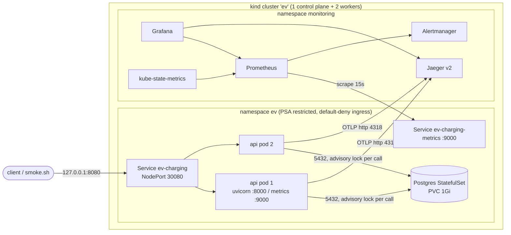
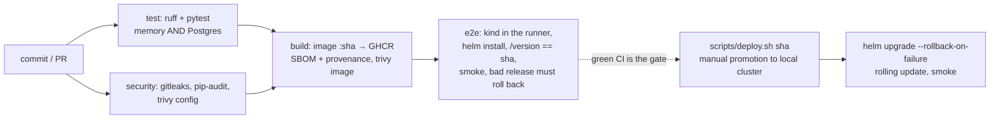

# DevOps design and decisions

Baseline: [`2d5080b`](https://github.com/khopade-works/ev-charging-backend/commit/2d5080bca198149bf84ac43b15528213584ef707) (tag `baseline`): a FastAPI service with an in-memory store, a single `threading.Lock`, pytest suites, and no container, CI, deployment or telemetry. This document explains what was added and why. Run instructions are in the [README](../README.md#run-it-on-kubernetes); alert responses are in the [runbook](RUNBOOK.md); proof is in [evidence](evidence/README.md).

## 1. Architecture

| Component | Kind | Why this workload type |
|---|---|---|
| API | Deployment, 2 replicas | Stateless once the data moved to Postgres: any pod can serve any request, pods are interchangeable, rolling updates are possible. 2 replicas so a release or a node loss never drops to zero (`maxUnavailable: 0`, PDB `minAvailable: 1`, spread across nodes). |
| Postgres | StatefulSet, 1 replica, PVC | Needs a stable identity and the same volume after a restart. One replica: no replication is needed for a local single-user system; a managed database (RDS/Cloud SQL) is what I would use in a cloud. |
| Probes, metrics | 2 ClusterIP/NodePort Services | `/metrics` lives on a separate port that the public NodePort does not expose. |

**Request path.** `curl 127.0.0.1:8080` → kind maps host port 8080 to node port 30080 on the control-plane container (bound to 127.0.0.1 only) → kube-proxy picks a Ready API pod (readiness = Postgres reachable) → uvicorn → FastAPI route → `ChargingService` → `PostgresStore.transaction()`: take a pooled connection, `BEGIN`, `pg_advisory_xact_lock`, load aggregates as JSONB, run the unchanged domain logic, write back changed aggregates, `COMMIT` → JSON response. Middleware records `http_requests_total`/latency and logs one JSON line with the trace id; the OTel instrumentation exports the HTTP and SQL spans to Jaeger.

**Failure boundaries.**

| Failure | What users see | What contains it |
|---|---|---|
| One API pod crashes | nothing (other replica serves) | liveness restarts it; Service only routes to Ready pods |
| Postgres down | requests fail until it is back | API readiness fails, so pods leave the Service instead of returning 500s; StatefulSet recreates the pod on the same PVC; pool replaces dead connections |
| Bad release (crash or never Ready) | nothing | `maxUnavailable: 0` keeps old pods; `helm --rollback-on-failure` restores the previous revision |
| Bad release (Ready but wrong) | errors / wrong results | smoke test + SLO burn alerts → `helm rollback` |
| A node is lost | nothing for the API; DB unavailable until rescheduled | anti-affinity spreads API pods; DB is the single point of failure (documented) |

## 2. Application changes made for operation

The domain, pricing and selection code is unchanged. Only the edges moved:

| Change | Why |
|---|---|
| `PostgresStore` (`ev/pgstore.py`) behind a `Store` Protocol | The baseline's own README named "Postgres" as its upgrade path. In-memory state would make every deploy wipe data, and would forbid more than one replica. |
| One `pg_advisory_xact_lock` per service call | Preserves the baseline's correctness model (one global lock, check-then-act is safe) across replicas with zero domain changes. Proven by a race test run with two stores/pools on one database; removing the lock makes it fail ([evidence](evidence/README.md#mutation-test)). Ceiling: writes are serialised. |
| `/healthz`, `/readyz`, `/version` | Liveness must not depend on the DB (a DB outage would otherwise restart every API pod for nothing); readiness must (stop routing to pods that can't serve); version = traceability. |
| Fail fast on bad config (`EV_PEAK=bogus` exits) | A bad release then never becomes Ready, so the rollout stops and is rolled back instead of serving. |
| Metrics, JSON logs, tracing | See section 5. |

## 3. CI/CD and release

| Decision | Alternatives considered | Why this one / when I'd switch |
|---|---|---|
| GitHub Actions, one workflow, jobs `test`/`security` → `build` → `e2e` | Jenkins, GitLab CI | Repo is on GitHub; free runners; no server to run. |
| Image tag = full git sha, never `latest` | semver tags, `latest` | Immutable and traceable: sha → image → pod → `/version`. A semver tag would be added on top for public releases. |
| Build once, deploy that artifact | rebuild per environment | The image that passed scans and e2e is the one that runs. |
| Every change is deployed to an ephemeral kind cluster in CI | none / mocks | Proves the chart installs, the app becomes Ready, the user journey works, and a bad release rolls back, on every PR. |
| Promotion to the local cluster is a **manual** `scripts/deploy.sh <sha>` that refuses commits without a green CI run | push-based CD from Actions; Argo CD | GitHub's runners cannot reach a cluster on my laptop, and a self-hosted runner on a public repo would let a PR run code on my machine. The manual step is the approval gate. With a reachable cluster I'd use Argo CD (pull-based, drift auto-correct) with CI bumping the image tag in git. |
| Rolling update, `maxSurge: 1`, `maxUnavailable: 0`, `minReadySeconds: 5` | blue-green, canary | Two stateless replicas and one schema: rolling is enough and zero-downtime. Canary needs traffic splitting (Argo Rollouts / a mesh) and enough traffic to judge; blue-green doubles resources. I'd move to canary when real users and an SLO-based analysis exist. |
| `--rollback-on-failure` + `helm rollback` | `kubectl rollout undo` | Helm rolls back config and image together and keeps a history with `sha=… ci=…` descriptions. |
| Schema: idempotent `CREATE … IF NOT EXISTS` at startup, under the advisory lock | migration Job / Alembic | One additive schema. Rollback to the previous image works because nothing is dropped. The first non-additive change needs real migrations (expand/contract). |

**Drift.** All objects come from one chart and one `values.yaml` (no per-environment copies); environment differences are `--set` flags at deploy time (CI sets `otel.endpoint=` and `pullPolicy=Never`). `helm get manifest ev -n ev | kubectl diff -n ev -f -` detects hand edits.

## 4. Security

| Area | Control |
|---|---|
| Secrets | DB and Grafana passwords are random, created by `scripts/bootstrap-cluster.sh` directly as Kubernetes Secrets, never in git, never printed; the app gets the DB password only as `PGPASSWORD` from a `secretKeyRef`. CI uses a throwaway random password per run. gitleaks scans the full git history on every run. |
| Container | Non-root uid 10001, read-only root filesystem, all capabilities dropped, no privilege escalation, `RuntimeDefault` seccomp; same for Postgres (uid 70). Namespace enforces Pod Security `restricted`, so a privileged pod is rejected ([evidence](evidence/README.md)). |
| Permissions | API ServiceAccount mounts no token (the app never calls the Kubernetes API). CI `GITHUB_TOKEN` is `contents: read` by default; only `build` gets `packages: write`. Checkout does not persist credentials. |
| Network exposure | Host ports bind to 127.0.0.1. NetworkPolicies: default-deny ingress; API takes 8000 from anywhere, 9000 only from `monitoring`; Postgres takes 5432 only from API pods; egress limited to DNS, Postgres, OTLP. |
| Supply chain | Base images pinned by digest; Python deps hash-locked (`--require-hashes`); every Action pinned to a commit SHA (trivy-action's tags were hijacked in March 2026, which is exactly the attack SHA pinning blocks); Dependabot proposes updates; images carry SBOM + provenance; pip-audit and Trivy (config + image, HIGH/CRITICAL fixable) fail the build. |
| Not done | The API has no authentication (baseline assumption A23, out of scope); no TLS (local only); Secrets are not encrypted at rest beyond Kubernetes defaults (in a cloud: External Secrets / Sealed Secrets + KMS). |

## 5. Observability and reliability

| Signal | What | Used for |
|---|---|---|
| Metrics (Prometheus) | RED per route template: `http_requests_total{method,route,status}`, `http_request_duration_seconds`; business: `ev_charging_sessions_started_total`, `…_session_start_rejected_total{reason}`, `…_sessions_ended_total{outcome}`; `ev_store_transaction_seconds` (lock wait + SQL); `ev_build_info{git_sha}` | SLO, alerts, dashboard, "which version is live" |
| Logs | One JSON line per request (`route`, `status`, `duration_ms`, `trace_id`, `span_id`) on stdout; uvicorn errors in the same format | `kubectl logs … \| jq`, jumping from a log line to its trace |
| Traces (OTel → Jaeger) | HTTP server span + one span per SQL statement (incl. the advisory lock) | Where the time goes: lock wait vs query vs app |
| Kubernetes state | kube-state-metrics | Ready replicas, DB readiness |

SLO: 99.5% of non-probe requests are not 5xx. Multi-window burn-rate alerts (14.4× over 5m and 1h; 6× over 30m and 6h) page on budget spend instead of single spikes. User success is measured separately (session starts vs rejections), because a 409 "no free connector" is a correct answer that still means a driver didn't charge. Each alert links to a runbook entry with the response and the recovery check.

**Known blind spot:** these metrics are measured by the server. If no pod is Ready, requests never reach it and the error ratio shows nothing; `EvChargingNoReadyPods` and `EvChargingDatabaseDown` cover that, and a black-box probe (blackbox-exporter on `/readyz` through the NodePort) would be the next addition.

## 6. What would change under different requirements

| If… | I would… |
|---|---|
| write throughput matters | replace the global advisory lock with the row-level claim (`UPDATE … WHERE status='AVAILABLE'` + partial unique indexes), then add an HPA on CPU/latency. Today an HPA would add pods that queue on the same lock. |
| this ran in a cloud | managed Postgres with backups and PITR, Gateway API + TLS instead of NodePort, External Secrets, Argo CD, Terraform for the cluster. |
| there were real users | canary releases with automated analysis on the SLO metrics, black-box probes, Alertmanager routed to a pager. |
| the schema changed incompatibly | migration Job before the rollout, expand/contract so the previous image still works during rollback. |
| Postgres must survive a node loss | a replicated operator (CloudNativePG) or a managed database. |
